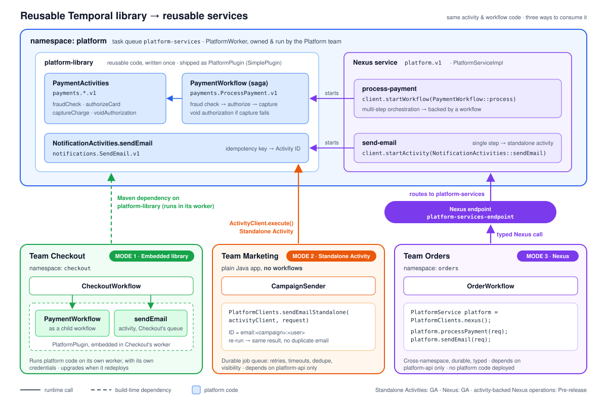

# Reusable Temporal libraries → reusable services (Java)

This demo shows how a **platform team** can build a set of Temporal activities and
child workflows **once**, and how other teams can reuse them in three ways:

| # | Mode | Who uses it here | What the team depends on | Where the platform code runs |
|---|------|------------------|--------------------------|------------------------------|
| 1 | **Embedded library**: in-process activities plus a child workflow | Team **Checkout** | `platform-library` (the implementations) | On Checkout's worker, in Checkout's namespace |
| 2 | **Standalone Activities**: a durable job queue, with no workflow | Team **Marketing** | `platform-api` only | On the platform worker, in the `platform` namespace |
| 3 | **Nexus**: a typed, cross-namespace service | Team **Orders** | `platform-api` only | On the platform worker, in the `platform` namespace |

The activity and workflow code doesn't change between modes. Only the way it is called changes.

> **Feature status (November 2026)**
>
> | Feature | Status |
> |---|---|
> | Plugins (`SimplePlugin`) | Available in all major SDKs; annotated `@Experimental` in Java |
> | Standalone Activities | GA in Temporal Cloud; self-hosted from Server v1.32.0 / CLI v1.9.1; Java SDK v1.39+ |
> | Standalone Activity operator commands (Pause, Reset, Update Options) | Public Preview |
> | Nexus, Workflow-backed Operations | GA |
> | `@TemporalOperation` handler style (Java) | Pre-release |
> | Nexus Operations backed by a Standalone Activity (`TemporalNexusClient.startActivity`) | Pre-release |
> | Standalone Nexus Operations (non-Workflow callers) | Public Preview; not yet on HA Namespaces |

---

## Architecture



### Module layout and dependency arrows

```
platform-api        PUBLIC CONTRACT: records, @ActivityInterface / @WorkflowInterface /
                    Nexus @Service interfaces, stable versioned type names, caller helpers.
                    No implementations.
platform-library    → platform-api       Implementations, packaged as PlatformPlugin (a SimplePlugin)
platform-service    → platform-library   Nexus @ServiceImpl + PlatformWorker (run by the platform team)

team-checkout       → platform-library   mode 1
team-marketing      → platform-api       mode 2
team-orders         → platform-api       mode 3
```

In a real organization each module would be its own artifact or repo. The thing to notice is
the dependency direction: **service-mode consumers never compile against platform
implementation code.**

---

## Design points

**1. A small contract module (`platform-api`)**
- Activity and workflow types have explicit names with a version (`notifications.SendEmail.v1`), so you can refactor the Java code without breaking callers.
- `PlatformService` is the Nexus contract. Callers get compile-time-checked stubs and don't need to know whether an operation runs a workflow or an activity.
- `PlatformClients` builds in the platform's recommended timeouts, retry policy, ID conventions and endpoint name, so consuming teams never hard-code a namespace or task queue.

**2. Business-key IDs make every mode idempotent**
- `email:<idempotencyKey>` is the Activity ID, both for standalone calls and for Nexus calls.
- `payment:<orderId>` is the Workflow ID.
- Standalone calls also set `USE_EXISTING` and `REJECT_DUPLICATE`. When Marketing re-runs a campaign, nobody gets a second email: the caller attaches to the original execution and gets its result back.

**3. The library ships as a Temporal plugin: `PlatformPlugin extends SimplePlugin`**
- One object carries everything a worker needs to host platform code: the workflow and activity registrations, plus cross-cutting behaviour. Here that's `PlatformAuditInterceptor`, which logs every platform activity execution with how it was invoked (standalone or workflow), the attempt number, duration and outcome.
- You attach it through options, not registration code. The same plugin is used by the platform worker, Checkout's worker and the unit tests, so nothing can drift apart:
  ```java
  WorkerFactory.newInstance(client, WorkerFactoryOptions.newBuilder()
      .setPlugins(new PlatformPlugin(config, "checkout"))   // optional: scope to one task queue
      .build());
  ```
- Checkout gets the platform's interceptor without writing any code for it. A static `register(worker)` helper can't do that, because interceptors, data converters and encryption codecs, and context propagators all live in factory or client options.
- `PlatformWorker` also shows the builder style: the Nexus service is added as `SimplePlugin.newBuilder("com.example.platform.nexus").registerNexusServiceImplementation(...)`.
- `SimplePlugin` is `@Experimental` in Java SDK 1.41.

**4. Two kinds of Nexus operation in one service** (`PlatformServiceImpl`)
- `process-payment` calls `client.startWorkflow(...)` for multi-step orchestration (the saga).
- `send-email` calls `client.startActivity(...)` for a **single-step job**. This avoids a wrapper workflow, which means less overhead and fewer billable actions. The server delivers the activity's result back to the caller's workflow through a Nexus completion callback.

**5. When to use each mode**

| | Embedded library | Standalone Activity | Nexus |
|---|---|---|---|
| Caller is a workflow | ✅ | ❌ (not allowed from workflow code) | ✅ |
| Caller is plain app code (REST, cron, Lambda) | ❌ | ✅ | ✅ (Standalone Nexus Operation, Public Preview) |
| Crosses namespace boundaries | ❌ | Caller needs access to the platform namespace | ✅ through the endpoint |
| Who deploys, scales and holds credentials | Each consuming team | Platform team | Platform team |
| Who rolls out a fix | Every consumer has to upgrade | Platform team only | Platform team only |
| Extra network hop | None | One | One |

---

## Run it

Prerequisites: Java 21+, Maven, and a recent **Temporal CLI** (`brew upgrade temporal`). Standalone Activities need CLI v1.9.1+ (Server v1.32.0+). The activity-backed `send-email` Nexus operation is Pre-release: on CLI 1.7.2 (Server 1.31.1) it never delivers its result back to the calling workflow.

```bash
make server            # terminal 1: dev server with namespaces platform, orders, checkout
make setup             # once: create Nexus endpoint platform-services-endpoint
make build && make test

make platform-worker   # terminal 2
make orders-worker     # terminal 3
make checkout-worker   # terminal 4

make checkout          # mode 1: library
make marketing         # mode 2: standalone activities (+ dedupe on re-run, + visibility)
make orders            # mode 3: Nexus (happy path, fraud decline, saga compensation)
```

Then open the UI at http://localhost:8233:
- `platform` namespace → **Activities** shows the standalone `email:*` executions, with the summary each caller supplied.
- `orders` namespace → each `order:*` workflow shows its Nexus operations, with links to the payment workflow and the email activity in the `platform` namespace.
- `checkout` namespace → `payment:CART-*` is a **child** workflow, because the library runs in Checkout's own namespace.

You can also try the CLI:

```bash
temporal activity list  --namespace platform
temporal activity count --namespace platform --query "ActivityType = 'notifications.SendEmail.v1'"
temporal activity execute --namespace platform --task-queue platform-services \
  --type notifications.SendEmail.v1 --activity-id email:cli-test --start-to-close-timeout 30s \
  --input '{"idempotencyKey":"cli-test","to":"me@example.com","template":"hello"}'
```

### Demo knobs
- `simulateOutage=true` in the email vars makes the first attempt fail, so you can watch Temporal retry it.
- Card `tok_declined` is rejected by the fraud check (result: `DECLINED`).
- Card `tok_capture_fails` fails at capture, and the saga voids the authorization (result: `VOIDED`).

### Temporal Cloud
`TemporalConnection` reads `TEMPORAL_ADDRESS`. To run against Cloud, add TLS or an API key there, and
create the Nexus endpoint in Cloud with an allowlist of caller namespaces.
