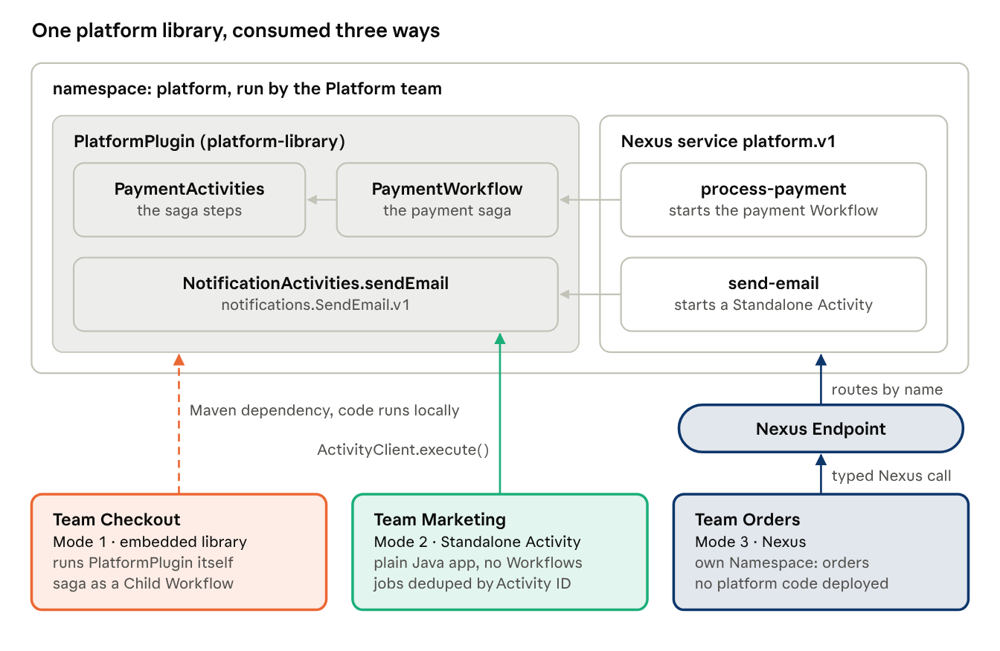
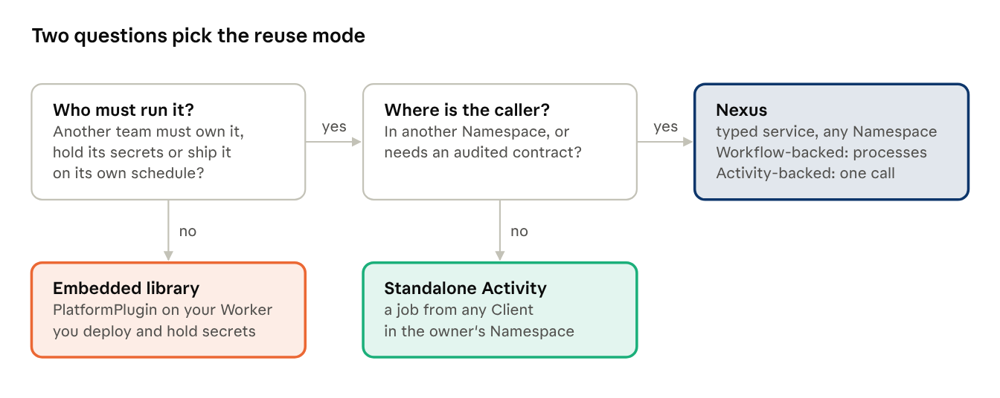

# Build once, reuse everywhere: sharing Temporal Activities and Workflows across teams

Nov 25, 2026 · @Adam Quan

You can reuse Temporal code at three levels. You can share the **code** inside each team's own Workers. You can share a **running capability** inside one Namespace with Standalone Activities. Or you can share a **contract** across Namespaces with Nexus. This post walks through all three with one small, runnable Java project, so you can see exactly what changes between them and what stays the same.

Sooner or later every company running Temporal finds the same thing: three teams have written three versions of "charge a card" and four versions of "send an email". Each copy has its own timeouts, retry policy and bugs. The fix is not just "make a library". It's choosing *how* other teams consume that library, and Temporal now gives you three good answers.

The good news: **the Activity and Workflow code is identical in all three**. Only the way it is called changes. So you can start simple and promote a capability to a service later without rewriting it.

The full demo code is on GitHub: [reusable](https://github.com/adam-quan/reuse).

## The example: one platform team, three consumers

A **Platform team** owns two capabilities that everyone needs:

- **Send an email.** One Activity, `notifications.SendEmail.v1`.
- **Take a payment.** A small saga Workflow, `payments.ProcessPayment.v1`: fraud check, authorize the card, capture the charge, and void the authorization if the capture fails.

Three other teams want to use them, each in a different way:

| Team | What they have | How they reuse the platform | What they depend on |
| --- | --- | --- | --- |
| Checkout | Workflows in their own Namespace | **Mode 1: embedded library.** Run the payment saga as a Child Workflow on their own Worker. | `platform-library` (the implementations) |
| Marketing | A plain Java app, no Workflows | **Mode 2: Standalone Activities.** Send campaign emails as durable jobs. | `platform-api` only |
| Orders | Workflows in their own Namespace | **Mode 3: Nexus.** Call payments and email as a typed service across Namespaces. | `platform-api` only |

The project is a Maven build with six modules. Three belong to the platform team and three are the consuming teams:

```
platform-api        the contract: types, interfaces, names, caller helpers (no implementations)
platform-library    -> platform-api       the implementations, packaged as a Temporal Plugin
platform-service    -> platform-library   the platform's Worker + its Nexus service

team-checkout       -> platform-library   mode 1
team-marketing      -> platform-api       mode 2
team-orders         -> platform-api       mode 3
```

Notice the arrows. Teams using the platform as a *service* (modes 2 and 3) never compile against platform implementation code. That is what lets the platform team ship a fix without asking anyone to redeploy.




The platform code lives in one place. Checkout copies it into its own Worker; Marketing and Orders call the platform's Worker, directly or through the Nexus Endpoint.

## Step 1: publish a small contract

A reusable Activity or Workflow is a public API. Its name, input, output and errors are a contract other teams build on. So the first thing the platform team ships is a tiny `platform-api` module with **no implementation code in it**.

Three rules make that contract safe to depend on.

**Use one input record and one output record.** Adding an optional field later stays compatible; adding a positional argument does not. Nexus Operations take exactly one input, so this also keeps a later move to Nexus free.

```java
public record EmailRequest(String idempotencyKey, String to, String template, Map<String, String> vars) {}
public record EmailResult(String messageId, String provider) {}
```

**Give every type an explicit, versioned name.** If you rely on the default (the Java method name), a harmless rename breaks every running Workflow and Client that refers to it.

```java
@ActivityInterface
public interface NotificationActivities {
  @ActivityMethod(name = "notifications.SendEmail.v1")
  EmailResult sendEmail(EmailRequest request);
}

@WorkflowInterface
public interface PaymentWorkflow {
  @WorkflowMethod(name = "payments.ProcessPayment.v1")
  PaymentResult process(PaymentRequest request);
}
```

**Ship sensible defaults with the contract.** A `PlatformClients` helper class builds in the recommended timeouts, retry policy and ID conventions, so consuming teams never hard-code a Task Queue, Namespace or Endpoint name. You will see it used in modes 2 and 3 below.

## Step 2: package the implementation as a Plugin

The implementations live in `platform-library`. Instead of asking every team to call `registerWorkflowImplementationTypes(...)` and `registerActivitiesImplementations(...)` in the right way, the platform team packages everything as one **Temporal Plugin**. `SimplePlugin` exists in all the major SDKs ([Plugins guide](https://docs.temporal.io/develop/plugins-guide)).

```java
public class PlatformPlugin extends SimplePlugin {
  public record Config(String emailProvider, String paymentGateway) {}

  public PlatformPlugin(Config config, String taskQueue) {
    // Builder-configured parts are applied to the Worker factory for you.
    super(SimplePlugin.newBuilder("com.example.platform")
        .addWorkerInterceptors(new PlatformAuditInterceptor()));
    // ... keep config and taskQueue
  }

  @Override
  public void initializeWorker(String taskQueue, Worker worker) {
    super.initializeWorker(taskQueue, worker);
    if (this.taskQueue != null && !this.taskQueue.equals(taskQueue)) return; // optional scoping
    worker.registerWorkflowImplementationTypes(PaymentWorkflowImpl.class);
    worker.registerActivitiesImplementations(
        new NotificationActivitiesImpl(config.emailProvider()),
        new PaymentActivitiesImpl(config.paymentGateway()));
  }
}
```

Why a Plugin and not a static `register(worker)` helper?

- **It carries more than registrations.** Interceptors, context propagators, data converters and encryption codecs all live in factory or client options. A helper that only sees a `Worker` can't install them; a Plugin can.
- **It is wired through options.** A consumer adds one object: `WorkerFactoryOptions.newBuilder().setPlugins(new PlatformPlugin(...))`.
- **Nothing drifts.** The platform's own Worker, every consuming Worker and the library's unit tests all use the same Plugin.

The demo's Plugin installs a small `PlatformAuditInterceptor` that logs every platform Activity execution, how it was invoked, the attempt, the duration and the outcome. Teams that embed the library get it without writing a line of code:

```
🔎 payments.FraudCheck.v1 via=workflow[payments.ProcessPayment.v1 payment:CART-...] attempt=1 took=0ms outcome=ok
🔎 notifications.SendEmail.v1 via=standalone-activity[email:black-friday:ada] attempt=1 took=2ms outcome=failed (RuntimeException)
🔎 notifications.SendEmail.v1 via=standalone-activity[email:black-friday:ada] attempt=2 took=0ms outcome=ok
```

**Inject dependencies.** Notice the `Config` record. Activities receive their clients and credentials through constructors, so each consumer (or a test) supplies its own. The library never reads globals or bundles secrets.

## Mode 1: embed the library in your own Worker

The Checkout team adds the Plugin to its Worker factory and registers only its own Workflow:

```java
WorkerFactory factory = WorkerFactory.newInstance(client,
    WorkerFactoryOptions.newBuilder()
        .setPlugins(new PlatformPlugin(new PlatformPlugin.Config("checkout-ses", "checkout-adyen"), "checkout"))
        .build());

Worker worker = factory.newWorker("checkout");
worker.registerWorkflowImplementationTypes(CheckoutWorkflowImpl.class); // Checkout's own code
```

Inside its Workflow it calls the platform through small helpers that hide the options:

```java
public String checkout(Cart cart) {
  PaymentRequest req = new PaymentRequest(cart.cartId(), cart.customerId(), cart.totalCents(), "USD", cart.cardToken());

  // Reusable CHILD WORKFLOW, running in Checkout's own Namespace
  PaymentResult pay = PlatformLibrary.paymentChild(req).process(req);

  // Reusable ACTIVITY, running on Checkout's own Task Queue
  PlatformLibrary.notifications().sendEmail(new EmailRequest("checkout-receipt:" + cart.cartId(), cart.email(), "receipt", Map.of()));
  return "cart " + cart.cartId() + ": payment " + pay.status();
}
```

`paymentChild(...)` sets the Child Workflow ID to `payment:<orderId>`, so the same order can never be charged twice.

**The library Workflow is a saga.** It uses the SDK's `io.temporal.workflow.Saga` helper. Each undo step is registered only after the step it undoes has succeeded, and the undo runs in a *detached* cancellation scope so it still executes if the Workflow is being cancelled:

```java
Saga saga = new Saga(new Saga.Options.Builder().setParallelCompensation(false).build());
try {
  auth = payments.authorizeCard(req);
  saga.addCompensation(payments::voidAuthorization, auth);
  Capture capture = payments.captureCharge(req, auth);
  return PaymentResult.captured(req.orderId(), auth.authId(), capture.captureId());
} catch (ActivityFailure | CanceledFailure e) {
  Workflow.newDetachedCancellationScope(saga::compensate).run();
  // rethrow cancellation, otherwise return VOIDED
}
```

**When it fits:** the logic is generic, carries no shared secrets, and the same team (or a close one) runs it.

**What it costs.** Every consuming team now deploys, scales and holds credentials for platform code. Every upgrade needs every consumer to bump, test and redeploy. And because library Workflow code replays inside *other teams'* histories, any change to its control flow must be replay-safe:

- Guard new steps with `Workflow.getVersion("payments.<change>", ...)`, prefixing patch IDs with the library name so they never collide with a consumer's own patches.
- Gate every release with replay tests against real histories collected from consuming teams (`WorkflowReplayer.replayWorkflowExecution(...)`).
- To rename a type or break its input, register a new `...V2` type and keep the old one until its executions drain.

Those costs are the signal to move a capability to one of the service modes.

## Mode 2: Standalone Activities, a durable job queue

The Marketing team has no Workflows at all. Its campaign tool is plain Java; it could just as well be a REST handler, a cron job or a Lambda. It still wants retries, timeouts, deduplication and visibility for every email.

A [Standalone Activity](https://docs.temporal.io/standalone-activity) is exactly that: an Activity Execution started directly by a Temporal Client, with no Workflow around it. The key point for reuse is that **the Activity definition and Worker registration are identical** to a Workflow Activity. The platform's Worker already hosts `SendEmail`, so it is already a job-style service. No code change needed.

The caller uses an `ActivityClient` connected to the platform's Namespace. The contract module wraps it in a one-line helper:

```java
public static EmailResult sendEmailStandalone(ActivityClient client, EmailRequest req) {
  String id = "email:" + req.idempotencyKey();      // business key = dedup key
  StartActivityOptions options = StartActivityOptions.newBuilder()
      .setId(id)
      .setTaskQueue("platform-services")
      .setStartToCloseTimeout(Duration.ofSeconds(30))
      .setScheduleToCloseTimeout(Duration.ofMinutes(10))
      .setRetryOptions(Platform.defaultRetryOptions())
      .setIdConflictPolicy(ACTIVITY_ID_CONFLICT_POLICY_USE_EXISTING)    // running? attach to it
      .setIdReusePolicy(ACTIVITY_ID_REUSE_POLICY_REJECT_DUPLICATE)       // finished? don't run again
      .build();
  try {
    return client.execute(NotificationActivities.class, NotificationActivities::sendEmail, options, req);
  } catch (ActivityAlreadyStartedException alreadyDone) {
    return client.getHandle(id, null, EmailResult.class).getResult();   // return the original result
  }
}
```

In the demo, Marketing sends a campaign to five users, then runs the **same** campaign again to simulate a crashed job runner. The second run returns the same message IDs and sends nothing:

```
[standalone] grace     -> msg_7cf30cfd
[standalone] ada       -> msg_47ac1e1b     (first attempt failed on purpose; Temporal retried it)
re-running the SAME campaign...
[standalone] grace     -> msg_7cf30cfd
[standalone] ada       -> msg_47ac1e1b
visibility: 13 SendEmail standalone executions on 'platform-services'
```

Standalone Activities are first-class executions, so `client.listExecutions(query)`, `countExecutions(query)` and `temporal activity list` all work.

Things worth knowing:

- **Cost.** One Standalone Activity is one Billable Action. A Workflow wrapping one Activity is two.
- **Fairness.** Give each consuming team its own fairness key, so one team's backlog can't starve the rest.
- **Start Delay** covers one-off deferred jobs, like a reminder in an hour. Recurring schedules still need a Workflow.
- **The ID stops duplicate submissions; idempotent code stops duplicate side effects on retry.** You still need both.
- **There is no access boundary.** Callers connect to the owner's Namespace. Once the caller lives in another Namespace, use Nexus.

Use this mode for shared **jobs** (send an email, sync a record, call a partner API) inside one trust boundary.

## Mode 3: Nexus, a typed service across Namespaces

The Orders team runs in its own Namespace and wants payments and email as a *service*: typed, durable, and owned by someone else. That is what [Nexus](https://docs.temporal.io/nexus) is for. The platform publishes a Service in its own Namespace behind a **Nexus Endpoint**, and callers depend only on the contract, never on the platform's Workflow IDs, Task Queues or code.

**1. Define the Service contract** in `platform-api`:

```java
@Service(name = "platform.v1")
public interface PlatformService {
  @Operation(name = "send-email")
  EmailResult sendEmail(EmailRequest request);

  @Operation(name = "process-payment")
  PaymentResult processPayment(PaymentRequest request);
}
```

**2. Implement it over the existing library code.** This is the most interesting part of the demo. One Service backs its two Operations differently, and callers can't tell:

```java
@ServiceImpl(service = PlatformService.class)
public class PlatformServiceImpl {

  // One durable call -> backed by a STANDALONE ACTIVITY (no wrapper Workflow)
  @TemporalOperation
  public TemporalOperationResult<EmailResult> sendEmail(
      TemporalOperationStartContext ctx, TemporalNexusClient client, EmailRequest req) {
    return client.startActivity(NotificationActivities.class, NotificationActivities::sendEmail, req,
        StartActivityOptions.newBuilder()
            .setId("email:" + req.idempotencyKey())
            .setTaskQueue("platform-services")
            .setStartToCloseTimeout(Duration.ofSeconds(30))
            .build());
  }

  // Multi-step process -> backed by a WORKFLOW
  @TemporalOperation
  public TemporalOperationResult<PaymentResult> processPayment(
      TemporalOperationStartContext ctx, TemporalNexusClient client, PaymentRequest req) {
    return client.startWorkflow(PaymentWorkflow.class, PaymentWorkflow::process, req,
        WorkflowOptions.newBuilder()
            .setWorkflowId("payment:" + req.orderId())   // business key: never charge twice
            .setTaskQueue("platform-services")
            .build());
  }
}
```

The platform Worker registers the handler alongside the library, again as a Plugin, this time using the builder style:

```java
SimplePlugin nexusService = SimplePlugin.newBuilder("com.example.platform.nexus")
    .registerNexusServiceImplementation(new PlatformServiceImpl())
    .build();

WorkerFactory.newInstance(client, WorkerFactoryOptions.newBuilder()
    .setPlugins(new PlatformPlugin(config, "platform-services"), nexusService)
    .build());
```

**3. Create the Endpoint** that routes to the platform's Namespace and Task Queue:

```bash
temporal operator nexus endpoint create \
  --name platform-services-endpoint \
  --target-namespace platform \
  --target-task-queue platform-services
```

**4. Call it from a Workflow** in any allowed Namespace. The Orders Worker registers only its own Workflow; no platform code runs there.

```java
public class OrderWorkflowImpl implements OrderWorkflow {
  private final PlatformService platform = PlatformClients.nexus();   // typed Nexus stub

  public OrderResult placeOrder(Order o) {
    PaymentResult pay = platform.processPayment(new PaymentRequest(o.orderId(), ...));
    EmailResult email = platform.sendEmail(new EmailRequest("order-" + pay.status() + ":" + o.orderId(), ...));
    return new OrderResult(o.orderId(), pay.status(), pay.failureReason(), email.messageId());
  }
}
```

A few practical notes:

- **Prefer async Operations.** A synchronous handler must finish within 10 seconds, and the Endpoint's circuit breaker trips after 5 consecutive retryable errors. Both Operations above are async.
- **Bind the Endpoint at registration.** The demo sets it inside `PlatformClients.nexus()`. In production you can instead bind it with `WorkflowImplementationOptions.setNexusServiceOptions(...)` on the caller's Worker, so Workflow code never names an environment.
- **Callers that aren't Workflows** (a BFF, an admin tool) can use a [Standalone Nexus Operation](https://docs.temporal.io/standalone-nexus-operation) and skip the caller Workflow entirely.
- **Evolve the contract by adding.** New Operations and optional fields are safe. For a breaking change, add `processPaymentV2` and keep the old one until callers migrate. The handler's internals stay private to the platform team.
- **Security comes from the Endpoint.** Its allowlist of caller Namespaces controls access, and a payload codec shipped in a shared Plugin encrypts data on both sides.

## Choosing a mode

Two questions decide it: **who must own the capability**, and **where the caller lives**. Whether it is backed by a Workflow or an Activity is a second, smaller choice.



If nothing needs isolating, a library is cheapest. Once ownership, credentials or deploy cadence split, serve it from the owner's Worker, and switch to Nexus as soon as a Namespace boundary sits between caller and owner.

|  | Embedded library | Standalone Activity | Nexus |
| --- | --- | --- | --- |
| Caller is a Workflow | Yes | No (not from Workflow code) | Yes |
| Caller is plain app code | No | Yes | Yes, with a Standalone Nexus Operation |
| Crosses Namespaces | No | No, caller connects to the owner's Namespace | Yes, through the Endpoint allowlist |
| Who runs, scales and holds credentials | Each consumer | Owner | Owner |
| Who ships a fix | Every consumer redeploys | Owner only | Owner only |
| Extra network hop | None | One | One |

Rules of thumb:

- **Same team, same Namespace, generic logic, no secrets** → embedded library.
- **Privileged credentials, its own scaling or deploy cadence, same Namespace** → Standalone Activity (or the owner's Task Queue).
- **A different team, a different Namespace, or an audited contract** → Nexus. Back it with a Workflow for multi-step processes and with a Standalone Activity for single durable calls.
- **A caller that isn't a Workflow** → Standalone Activity inside the Namespace, Standalone Nexus Operation across Namespaces.

Most organizations end up using all three, for different capabilities.

## Tips for anything reusable

These apply to all three modes.

1. **Use business keys as IDs.** `payment:<orderId>` for the Workflow, `email:<idempotencyKey>` for the Activity. Activities and Nexus Operations are at-least-once, so pass the same key to the downstream system too.
2. **Treat errors as part of the contract.** Publish non-retryable error types (`CaptureRejected`, `InvalidEmailRequest`) as constants. Everything else should stay retryable; never mark a transport error as non-retryable.
3. **Ship defaults, allow overrides.** Export recommended timeouts and retry policies with each Activity. Start-to-Close is mandatory; add a Heartbeat Timeout for anything long-running.
4. **Heartbeat long work.** Heartbeats carry cancellation and progress, so a retry can resume instead of starting over.
5. **Keep payloads small.** Pass references (record IDs, object-store keys), not whole documents.
6. **Test what consumers rely on.** The demo's library tests run through the same Plugin as production, and one test cancels the payment Workflow mid-capture and checks that the authorization is voided. For library Workflows, add replay tests against consumer histories.
7. **Observe it as a product.** Ship tracing interceptors and context propagators in a shared Plugin, watch Activity metrics by type, and alert on Nexus circuit-breaker trips.

### Where each feature stands (November 2026)

| Feature | Status |
| --- | --- |
| Plugins (`SimplePlugin`) | Available in all major SDKs; annotated `@Experimental` in Java |
| Standalone Activities | GA in Temporal Cloud; self-hosted from Server v1.32.0 / CLI v1.9.1; Java SDK v1.39+ |
| Standalone Activity operator commands (Pause, Reset, Update Options) | Public Preview |
| Nexus, Workflow-backed Operations | GA |
| `@TemporalOperation` handler style (Java) | Pre-release |
| Nexus Operations backed by a Standalone Activity | Pre-release |
| Standalone Nexus Operations (non-Workflow callers) | Public Preview; not yet on HA Namespaces |

If you run the demo locally, use a recent CLI. On an older dev server (CLI 1.7.x, Server 1.31), the activity-backed `send-email` Operation never delivers its result back to the calling Workflow.

## Try it yourself

You need Java 21+, Maven and a recent Temporal CLI.

```bash
make server            # dev server with namespaces platform, orders, checkout
make setup             # create the Nexus endpoint
make build && make test

make platform-worker   # in its own terminal
make orders-worker     # in its own terminal
make checkout-worker   # in its own terminal

make checkout          # mode 1: embedded library
make marketing         # mode 2: standalone activities, with dedupe on re-run
make orders            # mode 3: Nexus (happy path, fraud decline, saga compensation)
```

Then open the Temporal UI at `http://localhost:8233`. In the `platform` Namespace, the **Activities** view lists the standalone `email:*` executions. In `orders`, each Workflow shows its Nexus Operations with links into the platform Namespace. In `checkout`, the payment runs as a Child Workflow.

## Wrapping up

Start with a versioned library packaged as a Plugin, because the same Activity and Workflow definitions back every mode unchanged. Promote a capability to a service once one team owns it, holds its credentials, or needs to ship on its own schedule. Use Standalone Activities for job-style work inside a Namespace, and Nexus for anything that crosses one.

Further reading:

- [Standalone Activity](https://docs.temporal.io/standalone-activity)
- [Temporal Nexus](https://docs.temporal.io/nexus) and [Choosing a Nexus approach](https://docs.temporal.io/nexus/choosing-an-approach)
- [Standalone Nexus Operation](https://docs.temporal.io/standalone-nexus-operation)
- [Java Nexus feature guide](https://docs.temporal.io/develop/java/nexus/feature-guide)
- [Plugins guide](https://docs.temporal.io/develop/plugins-guide)
